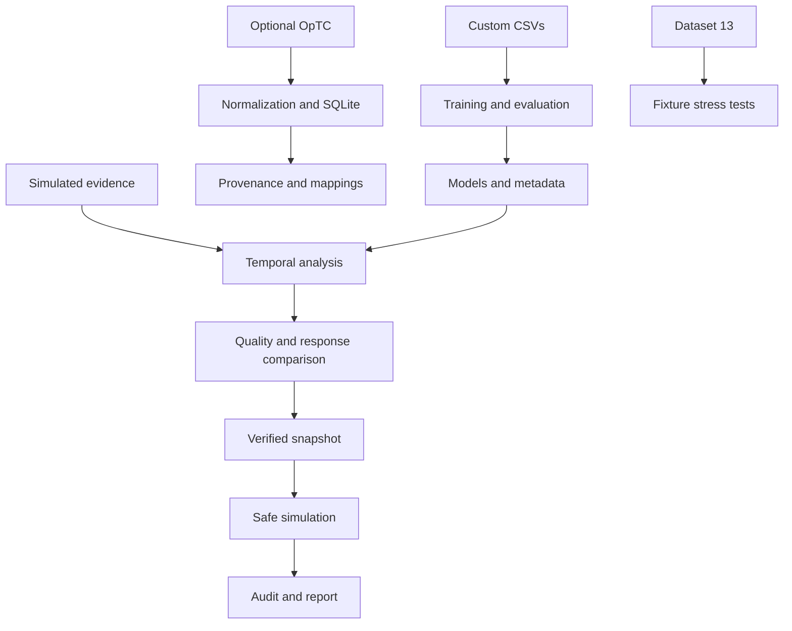

# FAPT-Guard — Cyberattack Prediction & Prevention

**An Intelligent Framework for Prediction and Prevention of Cyberattack using Digital Evidence Analysis**

## 1. Project Overview
The current v2 pipeline adds independent probability/conformal calibration, held-out synthetic evaluation, explicit ground-truth reveal, and prediction-aware simulated prevention. See [Temporal pipeline v2](docs/temporal-pipeline-v2.md) for implementation details, actual results, limitations and reproduction commands. The original v1.0.1 benchmark remains preserved.

Dataset-backed cybersecurity research prototype with a simulated investigation UI; not a production endpoint protection system.

The v1.0.1 synthetic temporal dataset trains and evaluates next-technique prediction in the existing workflow. See the [research validation report](docs/synthetic-temporal-validation.md) for ATT&CK normalization, hashes, supplied splits, actual metrics, limitations and commands. This is a synthetic benchmark, not real-world validation.

The [uncertainty and held-out evaluation report](docs/prediction-uncertainty-evaluation.md) documents predictive entropy, test ECE/Brier diagnostics, evidence traceability and why conformal coverage remains unmeasured. Run `python -m app.datasets evaluate-temporal` from `backend/` to evaluate the existing model without retraining it.

## 2. Research Problem
Containment can destroy volatile evidence. The project studies attack progression and evidence-aware response comparison with explicit synthetic-evaluation limitations.

## 3. Objectives
Connect observations, provenance, conservative ATT&CK mappings, model estimates, preservation and reproducible reporting.

## 4. Key Features
Command Center `/`, Research `/research`, Incidents `/incidents`, Graph `/graph`, Evidence `/evidence`, Prevention `/prevention`, Reports `/reports`. Temporal cutoffs, prediction explanations, evidence inspection, response comparison, verified snapshots and downloadable reports.

## 5. System Architecture
Next.js/React calls FastAPI. Python reads CSVs, STIX and joblib models. SQLite stores imported events and workflow state, initializing on demand without a separate database server.



Conceptual flow: ingestion → normalization → evidence → provenance → ATT&CK → current state → prediction → uncertainty → trust/poisoning → preservation → response evaluation → U-EPPC → simulation → audit → report → benchmark. Actual OpTC exploration is separate from the demo; a trained TC-FAPN pipeline is not implemented.

## 6. Technology Stack
Python 3.11+, FastAPI, SQLite, Pydantic, scikit-learn 1.9.1, joblib, NetworkX; TypeScript, Next.js 16.3.6, React 19, npm/package-lock and Playwright. Use Node 20.9+.

## 7. Project Structure
- `backend/app/`: API, schemas, services, training and import.
- `backend/config/research.json`: dataset registry and active weights.
- `backend/tests/`: unit/API tests.
- `frontend/src/`: UI; `frontend/tests/`: browser tests.
- `data/custom/`: supplied CSVs; `data/models/`: evaluation/provenance JSON.
- `fapt_guard/`: preserved preliminary package, not the running API.
- `docs/screenshots/`: actual existing UI captures.
- `DATASETS.md`, `RESEARCH_IMPLEMENTATION.md`: detailed methods.

## 8. Data Flow
Training reads datasets 10–12; 13 is evaluation-only. Incident analysis uses the selected evidence prefix. Predictions expose inputs/model versions. Simulation verifies a snapshot before recording the action.

## 9. Digital Evidence Analysis
Observed entities, timestamps, sensors, hashes, mappings and utility are inspectable. Missing measurements remain unavailable. Fixture hashes cover limited legacy fields; snapshot hashes cover complete serialized snapshots.

## 10. Temporal Provenance Graph
Evidence generates nodes/edges. Cutoffs exclude future observations. OpTC import preserves raw-byte hashes, identifiers, timestamp validation and conflicting observations.

## 11. MITRE ATT&CK Integration
Enterprise ATT&CK 19.2 supplies vocabulary. Mapping states distinguish confirmed behavior, candidate and unmapped. LSASS access does not prove credential dumping; STIX alone does not classify attacks.

## 12. Cyberattack Prediction

The timestamp-based future prediction pipeline, data contract, qualification checks and current measured results are documented in [Future prediction research report](docs/future-prediction.md). Genuine future ATT&CK prediction remains unavailable with the supplied tables; the existing synthetic next-stage demonstration is shown separately. Run `python -m app.prediction_audit` from `backend` to refresh readiness and synthetic holdout diagnostics.
Six baselines: CDFU, ACES, AFIP, trust, poisoning and synthetic next-stage classification. Stage prediction uses previous/current stages and current technique. Targets follow a deterministic transition rule; perfect synthetic accuracy is not real forecasting validation. Next-technique prediction and trained TC-FAPN are unavailable.

## 13. Prediction Uncertainty
Normalized entropy is displayed, not calibrated risk. Conformal coverage is not measured.

## 14. Evidence Trust / Poisoning Analysis
Incident trust/utility use disclosed heuristics. Missing independent sensor measurements remain null. Perfect dataset poisoning results are vulnerable to proxy-label leakage; reduced-feature scenario holdouts yield macro F1 approximately 0.469–0.982.

## 15. Anti-Forensic Analysis
AFIP accuracy 0.613, macro F1 0.08806; 987/1,000 predictions are `none`. Diagnostics expose weak minority-class performance. Advisory preservation is not validated prediction of host behavior.

## 16. Predictive Evidence Preservation
Snapshots, SHA-256 verification, linked custody and action context are stored. No live acquisition occurs. Legacy rows are unsealed. Without an external anchor, tail truncation or full database replacement cannot be ruled out.

## 17. Prevention Decision / U-EPPC
Balanced objective: 0.40 residual risk + 0.30 normalized evidence loss + 0.15 business impact + 0.10 cost + 0.05 opportunity loss. Contributions/ELC scale are exposed. ACES survival is predicted. Runtime weights are in `backend/config/research.json`; preliminary YAML is not active backend configuration.

## 18. FAPT-Bench
One descriptor per 14 families is selected. Twelve execute corruption operators on six fixture events; drift/unseen techniques are unmeasured. Retention, anomalies and distribution stability are measured; accuracy, true trust error, host survival and coverage are unavailable. Expected CSV scores are not measurements.

## 19. Dataset Information
| Dataset | Rows | Purpose |
|---|---:|---|
| FAPT-Guard Cyber-Forensic Response (10) | 7,700 | Utility/response outcomes |
| FAPT Anti-Forensic (11) | 5,000 | AFIP/synthetic progression |
| FAPT Evidence Trust & Poisoning (12) | 8,000 | Trust/poisoning |
| FAPT-Bench 2.0 (13) | 1,890 | Evaluation descriptors |

Project-supplied synthetic/research tables, not authentic OpTC observations. Dataset 11 declares rule-based labels; 13 declares synthetic ground truth. Original generation scripts, seeds and creation timestamps were not supplied. For 10/12 the generation method is **Not currently recorded**. Training reproduces models, not original CSV generation. Versions, columns, targets, hashes and splits are in `data/manifest.json` and `data/models/training_report.json`.

External ATT&CK JSON (~54 MB) and OpTC material are excluded; download through the official-source helper below. No raw OpTC is available. See [DATASETS.md](DATASETS.md). No blanket license is asserted for third-party material or supplied datasets.

## 20. Model Information
`data/models/training_report.json` records algorithms, hashes, timestamps, features, targets, parameters, seeds and metrics. Original baselines use grouped 80/20 splits; progression uses grouped 60/20/20. CDFU MAE 0.02255; ACES MAE 0.01281; trust MAE 0.00488. See [findings](RESEARCH_IMPLEMENTATION.md). Binaries are regenerated; existing metadata remains for comparison.

## 21. Installation
Windows PowerShell, from a fresh clone:
```powershell
python -m venv .venv
.\.venv\Scripts\python.exe -m pip install -r backend/requirements-research.txt
cd frontend
npm.cmd ci
cd ..\backend
..\.venv\Scripts\python.exe -m app.fetch_public_data mitre
..\.venv\Scripts\python.exe -m app.datasets train
cd ..
```
Custom CSVs are included. Internet is needed for dependencies, ATT&CK and build-time Google Fonts. On Unix use `.venv/bin/python` and `npm` equivalents.

## 22. Running the Project
Terminal 1, from repository root:
```powershell
cd backend
..\.venv\Scripts\python.exe -m uvicorn app.main:app --host 127.0.0.1 --port 8000
```
Terminal 2, from repository root:
```powershell
cd frontend
npm.cmd run build
npm.cmd run start -- --hostname 127.0.0.1 --port 3000
```
Development: `npm.cmd run dev`. UI: http://127.0.0.1:3000; API docs: http://127.0.0.1:8000/docs.

## 23. Configuration
Copy `.env.example` to `frontend/.env.local` to override build-time `NEXT_PUBLIC_API_URL`. Default: loopback port 8000. CORS allows localhost/127.0.0.1 port 3000. Remote deployment needs deliberate authentication/CORS configuration.

## 24. Testing
From `backend/`:
```powershell
..\.venv\Scripts\python.exe -m unittest discover -s tests -v
..\.venv\Scripts\python.exe -m app.datasets evaluate
```
From `frontend/`, with both services running and Microsoft Edge installed:
```powershell
npm.cmd run lint
node node_modules/@playwright/test/cli.js test
```
Browser tests add simulated audit records. No CI badge is claimed.

## 25. Research Limitations
Synthetic labels, template leakage, imbalanced AFIP, missing OpTC/real next-technique outcomes, uncalibrated uncertainty, no causal response validation or production deployment. Local hashing is not independent attestation.

## 26. Safe Simulation Notice
No real shutdown, isolation, account disabling or invasive collection. INC-00001 / WIN-CLIENT-07 / user `kaushik` is the requested simulated demonstration:

| Evidence | Observation |
|---|---|
| EV-00001 | kaushik → LOGIN → WIN-CLIENT-07 |
| EV-00002 | OUTLOOK.EXE → OPEN → invoice.docm |
| EV-00003 | OUTLOOK.EXE → SPAWN → invoice.exe |
| EV-00004 | invoice.exe → SPAWN → powershell.exe (T1059.001) |
| EV-00005 | powershell.exe → CONNECT → 203.0.113.50 |
| EV-00006 | powershell.exe → ACCESS → lsass.exe (candidate T1003.001) |

Supplied state: Credential Access / LSASS Memory; malicious interpretation remains qualified.

## 27. Reproducibility
Use lockfile, requirements, CSV hashes, training and configuration. Databases, logs, caches, environments, external data and model binaries are excluded. Workflow state initializes fresh. Retraining updates artifact hashes/timestamps. Run `app.datasets evaluate` for fresh results. Screenshots: [reports](docs/screenshots/reports.png), [mobile prevention](docs/screenshots/mobile-prevention.png).

## 28. Future Work
Authorized OpTC/ground truth, temporally separated prediction and TC-FAPN, AFIP minority recall, independent poisoning evaluation, uncertainty calibration and authorized post-response outcome collection.
