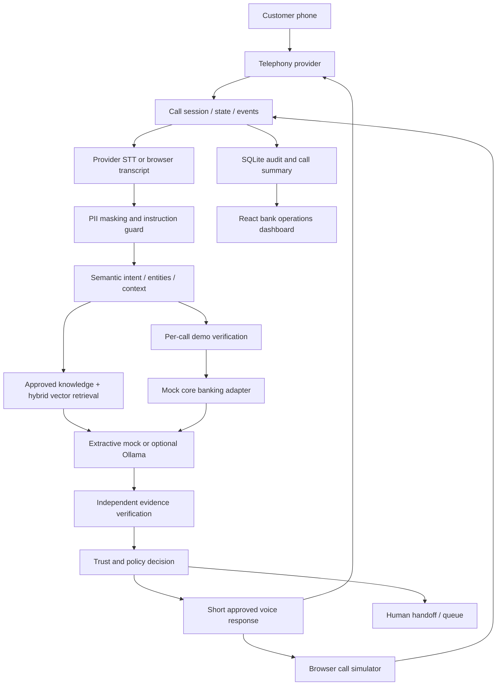

# Call Sense — Real-Time Voice AI Agent for Banking Support

Call Sense is a **phone-first banking support prototype**. A caller speaks to a banking support number; the bank's team uses the React application to monitor calls, review evidence, handle escalations and maintain approved knowledge.

The existing React/Vite + FastAPI + SQLAlchemy/SQLite project has been extended in place. Existing conversations, audit records, the original browser/text workspace, response verification and agent cases are preserved. No Streamlit is used.

**Everything bank-specific is fictional.** Call Sense Bank, demo customers, balances, cards, fees, rates and transactions are synthetic. This is not a certified banking deployment.

## Run locally

The local Python environment and frontend dependencies are installed. Start these in separate PowerShell terminals from the project directory:

```powershell
powershell -ExecutionPolicy Bypass -File scripts/start-backend.ps1
```

```powershell
powershell -ExecutionPolicy Bypass -File scripts/start-frontend.ps1
```

Open **http://127.0.0.1:5173**. API documentation is at **http://127.0.0.1:8000/docs**. Startup trains the small local semantic model and checks the knowledge index; allow time for the backend to become ready.

For a fresh checkout, install Python 3.11+ and Node 20.19+ or 22.12+, then run:

```powershell
powershell -ExecutionPolicy Bypass -File scripts/setup.ps1
```

The scripts handle the Node installation under `C:\Program Files\nodejs`. Python on this machine is under `C:\Program Files\Python314`. Tested dependency versions are in `backend/requirements.lock.txt`; direct dependencies are in `backend/requirements.txt`.

On Linux/macOS:

```bash
cd backend
python3 -m venv .venv
source .venv/bin/activate
pip install -r requirements.txt
uvicorn app.main:app --host 127.0.0.1 --port 8000
```

In another terminal:

```bash
cd frontend
npm ci
npm run dev
```

Stop a foreground server with Ctrl+C. If this assistant started background servers for you, their process IDs and logs are in `.runtime/server-processes.json` and `.runtime/*log`. Use `scripts/stop-local.ps1` to stop those recorded project processes before restarting manually.

## Four operating modes

| Mode | How to use it | Speech transport |
|---|---|---|
| `MOCK_CALL_MODE` | Live Calls -> select a demo profile -> Start call; type simulated caller utterances or click the microphone | Browser STT and browser TTS when enabled; no phone number |
| `BROWSER_VOICE_DEMO` | Live Calls -> select browser voice -> Start call -> grant microphone permission | Greeting, browser recognition, approved speech reply, then listening resumes |
| `TEXT_TEST_MODE` | Live Calls -> select text test -> Start call -> type utterances | Same call lifecycle and AI pipeline; no automatic audio |
| `REAL_PHONE_CALL` | A customer calls the configured provider number; the signed incoming webhook creates the call | Twilio Media Streams + Azure STT/TTS, or the preserved Gather/Say transport |

The default is mock mode, with **no paid API, model download or purchased number required**. The dashboard clearly indicates whether a real phone gateway is configured. Selecting real-phone mode does not place an outbound call.

The original workspace is retained under **Settings -> Open legacy text workspace**. Its history is under **Call History -> Legacy conversations**.

### A useful demonstration

1. Open **Live Calls**, choose `TEXT_TEST_MODE` or `MOCK_CALL_MODE`, select **CSB10001**, and start a call.
2. Ask `What is NEFT?` or `What happens if I miss one loan EMI?` to see evidence-grounded general information.
3. Ask `My card isn't working.` and then `Online.` to see clarification and session context.
4. Ask `What is my account balance?`. The answer is **VERIFY**, not an invented account balance.
5. Enter the fictional profile's displayed favourite colour: **blue**. Click **Verify demo**.
6. Repeat the balance question: the adapter returns **INR 24,850**, explicitly labeled synthetic.
7. Ask for the latest five transactions to read the configured fictional records.
8. Report `My card was stolen.` to see high-priority escalation. A verified demo card can be blocked using **Simulate card block**; no real card is changed.
9. Transfer the call to the simulated queue, then inspect the handoff in **Agent Queue**.
10. Inspect Call History, Analytics, Security Events and Evaluation.

Demo verification is deliberately a non-sensitive simulation, not a production authentication mechanism. Profile colours are visible to the operator and are not secrets. Each call starts unverified or partially verified; verification is not shared across calls. Challenge answers are not saved in authentication logs.

## What changed

- **112 banking intents** across 18 consumer-banking categories, with at least 18 training-style utterances per intent.
- **227 distinct approved knowledge records**: separate concept and procedure articles for each topic, plus structured product schedules. These are substantial, separately authored entries, not copies of a one-line FAQ.
- A local corpus-trained semantic index, word retrieval, character matching, query normalization, intent metadata and source-aware reranking.
- Safe password/PIN reset guidance is separated from secret disclosure. Ordinary informational questions do not require account verification.
- A mock core-banking adapter with three demo profiles, account balances, transactions, debit/credit cards, transfers, loans and deposits.
- Persisted call sessions, states, events, per-call authentication, structured summaries, live monitoring, silence handling and interruption hooks.
- Provider-independent telephony, mock call simulation, and an optional signed inbound Twilio integration.
- Operations navigation: Overview, Live Calls, Call History, Escalations, Agent Queue, Customers (Demo), Knowledge Base, Intent Library, Analytics, Evaluation, Security Events and Settings.
- Knowledge CRUD, disable/re-enable, approval, re-indexing, retrieval testing, knowledge-gap frequency tracking and administration audit logs.
- **368 evaluation queries**, including domain variations, acceptance examples, misspellings, sensitive inputs, injection attempts, multi-turn context and verified demo records.

See [the migration assessment](docs/MIGRATION.md) for the original limitations and reuse plan. The original documentation is retained in [docs/V1_README.md](docs/V1_README.md).

## Architecture



Call states are `RINGING`, `CONNECTED`, `LISTENING`, `TRANSCRIBING`, `UNDERSTANDING`, `RETRIEVING`, `VERIFYING`, `RESPONDING`, `SPEAKING`, `WAITING`, `ESCALATING`, `TRANSFERRED`, `COMPLETED` and `FAILED`.

A call links to the existing conversation/turn tables. Existing tables are preserved; call sessions/events, demo customers, authentication events, knowledge gaps and admin audit records are additive. Intent, retrieval, decision, verification and performance events remain grouped in per-turn JSON for atomic auditing. Existing historical evidence remains in the stored turn even after an article is disabled.

### Main modules

```text
backend/app/
  api/
    calls.py          Call creation, control, transcript socket and live monitoring
    telephony.py      Signed inbound speech/status webhooks and TwiML responses
    knowledge.py      Knowledge approval, CRUD, reindex, retrieval tests and gaps
    operations.py     Demo customers, intent tools, security and call analytics
    routes.py         Preserved v1 conversation, agent and evaluation endpoints
  services/
    catalog.py        Authored taxonomy and article metadata
    embeddings.py     Local LSA, word and character representations
    intent.py         Similarity classification, safety priority and entities
    rag.py            Chunk indexing, persistent vectors and hybrid retrieval
    core_banking.py   Provider interface and synthetic records
    calls.py          Call lifecycle, locking, authentication and orchestration
    telephony.py      Telephony interface, Mock and Twilio adapters
    speech.py         Browser/provider STT and TTS boundaries
    pipeline.py       Context, evidence, generation, decisions and handoff
    privacy.py        Redaction, credential boundary, injection and grounding checks
    decision.py       Independent RESPOND/CLARIFY/VERIFY/ESCALATE/ABSTAIN policy
    generation.py     Mock/Ollama generation and concise voice formatting
    evaluation.py     Reproducible evaluation and metrics
  domain/             Categorized authored topic data and product configuration
  knowledge_base/     Organized exported article records + retained v1 Markdown
  evaluation/         Explicit labeled evaluation JSON
  database/store.py   SQLAlchemy persistence and additive v2 models
frontend/src/
  pages/Calls.jsx       Phone-style simulator, live monitor and replay
  pages/Management.jsx  Knowledge, intents, customers and security
  pages/Operations.jsx  Overview, analytics, handoff queue, evaluation and settings
  pages/Workspace.jsx   Preserved original browser/text tools
  hooks/useCallAudio.js Browser speech and interruption controls
```

## Banking understanding and retrieval

The runtime does not select one of six scripted scenarios. Six old shortcuts remain only in the legacy test workspace.

The default semantic model is **local latent semantic analysis (LSA)** fitted to the authored banking corpus and example utterances. It is not a pretrained neural language model. Intent confidence combines measurable word, semantic and character similarities. Character matching and normalization help with common misspellings and speech-like phrasing; safety-sensitive signals take precedence without inventing a high confidence value.

Knowledge is split at sentence boundaries. Each approved chunk has a stored vector. Retrieval combines semantic cosine, a corpus-adaptive word index, character similarity, intent metadata and question type. Concept questions prefer definitions; procedure questions prefer actionable guidance. Administrative additions enter the lexical index after re-indexing, while the semantic model remains grounded in the authored domain corpus. Index fingerprints prevent reuse of incompatible vectors after a corpus/model revision.

Article metadata includes ID, title, category, subcategory, supported intents, risk, authentication flag, review date, source type, keywords, aliases, approval, enabled state and index status. Canonical seed content lives in `app/domain`; exported records live under categorized `app/knowledge_base` folders. Administrative edits live in SQLite and survive restarts.

The answer layers are approved structured knowledge, cross-domain retrieval, general concept/glossary content, clarification, and finally verification/escalation/abstention. Unknown topics are recorded as knowledge gaps, not silently learned from a model response.

`answer_type` distinguishes `GENERAL_BANKING_INFORMATION`, `BANK_POLICY`, `DEMO_ACCOUNT_INFORMATION`, `CLARIFICATION`, `SECURITY_GUIDANCE`, `ESCALATION` and `ABSTENTION`.

## Safety, trust and privacy

The decision engine is independent of the generator. It protects account access, refuses credential disclosure and instruction overrides, prioritizes active fraud, asks for missing channels and withholds unsupported generation. Reset guidance is allowed because explaining a trusted recovery process is different from requesting or revealing a secret.

Generated factual sentences must appear in approved retrieved evidence, and prohibited credential requests or execution claims are rejected. Synthetic account answers use evidence constructed from the verified core adapter record. Unverified proposed generations are withheld from the transcript and audit payload. Only observable checks are displayed; no private model reasoning is exposed.

```text
Trust = 25 x intent similarity
      + 25 x retrieval relevance
      + 30 x evidence grounding
      + 20 x context certainty
      - ambiguity, risk, missing-authentication, injection and missing-evidence penalties
```

The score is clamped to 0-100, its components are visible, and it is not a calibrated probability or an authorization token.

PII masking runs before storage, retrieval and model generation. Email, long numeric identifiers and labeled credential disclosures are removed. Credential submissions receive protective guidance and are not read back. Raw audio is not stored. Regex and phrase guards are baseline controls, not complete protection against every language or obfuscation; only fictional data should be used.

The legacy transcript history and v2 call audit remain accessible. No automated retention purge or production encryption layer is claimed. Before connecting a public telephony gateway, an operations API token is required. It protects API calls; WebSocket authentication uses a subprotocol token rather than a URL query secret. A production system still needs identity-based roles, key rotation, rate limiting and deployment hardening.

## Browser voice, interruptions and silence

Browser voice mode uses Web Speech recognition and browser speech synthesis. Recognition can depend on browser-vendor network services and requires microphone permission. Speech is not uploaded to FastAPI by this adapter. A typed utterance follows the same call and banking pipeline.

After a reply, browser voice mode resumes listening. Click **Speak / interrupt** to cancel playback and start recognition; an interruption event is persisted. The browser adapter uses explicit interruption. The real-phone media adapter supports audio-triggered barge-in through Twilio clear/mark events. The waveform shows call/listening state, not measured microphone amplitude.

Silence values configure presence prompts only: 30, 90 and 180 seconds by default. Normal silence never ends or transfers a call. Browser recognition restarts after ordinary onend and TTS completion; microphone permission/device errors leave the call active for typed input or an explicit retry. Media Streams stay open across utterances, and Gather empty-result callbacks reprompt. MAX_CALL_DURATION_MINUTES=0 leaves call duration unlimited. Audio startup/end detection metrics are only populated when the relevant provider exposes them; unavailable measurements stay null.

The `WS /api/telephony/audio/{call_id}` browser adapter accepts final transcript/control events. It **does not accept raw PCM/audio frames**; unsupported binary packets receive an explicit error. The separate signed `WS /api/telephony/media` route handles Twilio raw audio. Future SIP/Exotel adapters can reuse the banking pipeline.

## Optional real inbound telephone integration

The recommended media transport connects incoming Twilio calls to a signed bidirectional WebSocket. It buffers 8 kHz mu-law audio into bounded utterances, uses Azure Speech for STT/TTS, and invokes the existing banking pipeline for every turn. The original Gather/Say transport remains available.

Follow [Real Phone Mode Setup](docs/REAL_PHONE_SETUP.md) for credentials, speech configuration, exact webhook URLs, ngrok, dashboard sign-in, manual call testing and troubleshooting. No number, credentials or real provider call was created by this implementation.

Use `APP_MODE=real_phone`, `TELEPHONY_PROVIDER=twilio`, `STT_PROVIDER=azure`, `TTS_PROVIDER=azure`, and fill the Twilio/Azure credentials, `PUBLIC_BASE_URL`, `PUBLIC_WS_URL` and `OPERATIONS_TOKEN` in your local `backend/.env`. The example file contains every field. Missing configuration is listed by `/api/telephony/health` and Settings ? Telephony. Operator sign-in creates an expiring HttpOnly session; credentials are not stored in browser storage.

Provider interfaces expose `receive_call`, `answer_call`, `stream_audio`, `send_audio`, `end_call`, `transfer_call` and `get_call_metadata`. Only Mock and Twilio adapters are implemented. SIP/Asterisk/FreeSWITCH and Exotel are extension targets, not advertised as connected integrations.

## Knowledge improvement workflow

1. An unsupported question becomes a **KnowledgeGap** with masked query, predicted intent, retrieved references, score, decision, timestamp and frequency.
2. Review **Analytics -> Top unanswered banking questions** and mark a gap Reviewed.
3. Open **Knowledge Base**, add or edit a meaningful article, assign supported intent IDs and confirm human approval.
4. Save. The changed record is **PENDING** and is not served in live retrieval.
5. Click **Re-index approved**. Approved, enabled content becomes available to future calls.
6. Use the retrieval tester, then mark the gap Resolved when appropriate.

Disabling an article removes it from retrieval immediately. Editing existing content invalidates its index. Restarting does not re-enable disabled articles or overwrite administrative edits. The LLM never writes banking policy.

Rates, fees, limits and fictional branch details originate in `backend/app/domain/products.json` or authored synthetic policy. Unconfigured facts are not silently filled with invented market values.

## Configuration

Defaults work without an `.env` file. Important settings:

| Setting | Default | Effect |
|---|---|---|
| `MOCK_MODE` | `true` | Extract approved sentences without a model API |
| `LLM_PROVIDER`, `LLM_MODEL` | `ollama`, `llama3.2` | Optional local generation when mock mode is false |
| `EMBEDDING_MODEL` | `local-lsa-128` | Current local model identifier; other model adapters are future work |
| `RAG_TOP_K` | `5` | Maximum distinct retrieved articles |
| `TELEPHONY_PROVIDER` | `mock` | Mock or configured Twilio |
| `STT_PROVIDER`, `TTS_PROVIDER` | `browser` | Browser defaults; media mode uses Azure; Gather uses provider speech |
| `VOICE_LANGUAGE` | `en-IN` | Initial English speech locale |
| `TTS_VOICE` | `alice` | Twilio speech voice |
| `TTS_ENABLED`, `ENABLE_TTS` | `true` | Browser speech output capability |
| `SILENCE_FIRST_SECONDS` | `30` | Initial presence prompt |
| `SILENCE_SECOND_SECONDS` | `90` | Additional waiting prompt |
| `SILENCE_END_SECONDS` | `180` | Final presence prompt; never a hangup |
| `SILENCE_FINAL_ACTION` | `continue` | Keep listening; `reprompt` is also accepted. Legacy end/transfer values migrate to continue. |
| `MAX_CALL_DURATION_MINUTES` | `0` | Unlimited; positive values intentionally cap call duration |
| `DATABASE_URL` | Project SQLite | SQLAlchemy database configuration |
| `OPERATIONS_TOKEN` / `ADMIN_API_TOKEN` | empty | Optional locally, mandatory with Twilio; HttpOnly dashboard session |

Privacy and injection guards remain enabled. These controls are not bypassed to improve answer rates. Local Ollama is optional and is still subject to strict extractive evidence verification; provider failure produces a safe abstention. No paid API key is required for the default flow.

PostgreSQL remains possible through a SQLAlchemy driver and connection URL, but this migration was tested against SQLite. Production database migrations, shared multi-worker coordination and an approximate-nearest-neighbor index remain future work.

## API guide

- `GET /api/config`, `/api/health`, `/api/telephony/capabilities`, `/api/telephony/health`
- `POST/DELETE /api/auth/session`; `WS /api/telephony/media` for signed Twilio bidirectional audio
- `POST /api/calls`; `GET /api/calls`; `GET /api/calls/{id}`
- `POST /api/calls/{id}/turns`, `/verify`, `/interrupt`, `/state`, `/transfer`, `/end`, `/demo-block-card`
- `WS /api/live-calls` for snapshots and state/turn/security events
- `WS /api/telephony/audio/{id}` for browser transcript/control events
- `POST /api/telephony/incoming`, `/turn/{id}`, `/status`, `/dial-ended/{id}` for signed provider webhooks
- `GET /api/demo-customers`; `GET /api/demo-customers/{id}` and `/{accounts|transactions|cards|loans|deposits|transfers}`
- `GET/POST /api/knowledge`; `GET/PUT/DELETE /api/knowledge/{id}`
- `POST /api/knowledge/reindex`, `/api/knowledge/test-retrieval`
- `GET /api/knowledge-gaps`; `PATCH /api/knowledge-gaps/{id}`
- `GET /api/intents`; `POST /api/intents/test`
- `GET /api/operations/analytics`, `/api/security-events`, `/api/escalations`
- `POST /api/evaluation/run`; `GET /api/evaluation/latest`
- Existing `/api/conversations`, `/api/ws/{conversation_id}`, case updates and original analytics remain available.

## Validation and research evaluation

```powershell
backend/.venv/Scripts/python.exe -m pytest backend/tests -q -c backend/pytest.ini
```

```bash
cd frontend
npm run build
npm run test:e2e
```

Browser tests use installed Chrome and isolated servers on ports **8001 / 5174**, with a separate browser-test database. A speech-recognition test double verifies the browser adapter and interruption flow; physical microphone quality and carrier audio are manual tests.

The explicit dataset is `backend/app/evaluation/queries.json`, built by `backend/tests/build_evaluation.py`. It combines 330 domain wording variations and 38 acceptance/safety/context/account checks. It is intentionally labeled as synthetic: generated wording draws from the same domain taxonomy, so high scores do not demonstrate real-world generalization. Incorrect cases remain visible as REVIEW rather than being hidden.

Metrics include intent and top-2 intent accuracy, retrieval hit rate, grounding, unsafe-response proxy, correct/unnecessary escalation, clarification success, knowledge-gap rate, PII and injection detection, latency, trust and conversational turns. Evaluation runs do not create operational calls or inflate the knowledge-gap queue.

Validation guidance and limitations are in [docs/VALIDATION.md](docs/VALIDATION.md). The API dashboard can rerun the synthetic evaluation suite at any time; generated evaluation output is intentionally not committed.

## Screenshots

Actual browser-test captures:

- [Operations overview](docs/screenshots/operations-overview.png)
- [Verified demo call](docs/screenshots/live-call-verified.png)
- [Agent handoff](docs/screenshots/agent-handoff.png)
- [Mobile operations](docs/screenshots/operations-mobile.png)

## Remaining boundaries

This is a functioning local prototype with a configured-provider integration path, not a production SaaS launch. There is no real core-banking adapter, production identity/role system, trained VAD/echo cancellation, multilingual evaluation, validated acoustic accuracy, retention-management UI or regulatory certification. The demo challenge, local semantic model and rule-based guards need substantially stronger validation before handling real banking customers.

Research extensions include pretrained multilingual semantic embeddings, calibrated uncertainty, independent noisy-speech datasets, richer dialogue state, verified claim-level entailment, additional SIP providers, authenticated operator roles and retention controls.

References: [Twilio Gather](https://www.twilio.com/docs/voice/twiml/gather), [Twilio voice verbs](https://www.twilio.com/docs/voice/twiml), [FastAPI WebSockets](https://fastapi.tiangolo.com/advanced/websockets/), [scikit-learn latent semantic analysis](https://scikit-learn.org/stable/modules/generated/sklearn.decomposition.TruncatedSVD.html).

## Natural voice upgrade

Voice capture now supports mono 16 kHz PCM sent to backend faster-whisper, with Azure support and browser recognition fallback. Capture defaults are 150 ms sustained speech start, 1200 ms end silence, 300 ms pre/post roll and a 60-second utterance limit. Oversized utterances prompt a repeat; they do not end the call.

Install optional local speech support from the project root:

```powershell
backend/.venv/Scripts/python.exe -m pip install -r backend/requirements-speech.txt
backend/.venv/Scripts/python.exe scripts/setup-speech.py --model base.en
```

Use `STT_PROVIDER=faster_whisper`, `WHISPER_MODEL=base.en`, `WHISPER_DEVICE=auto` and `WHISPER_COMPUTE_TYPE=int8`. An approved local model folder can be used for WHISPER_MODEL. Startup never downloads model weights. Missing weights produce explicit readiness information and browser fallback. On this machine the package installed, but network policy blocked the model download; local Whisper recognition is not yet validated.

Customer responses use approved professional wording; operator records retain evidence provenance. The inspector shows redacted raw and normalized text, actual provider confidence when available, and corrections. Uncertain banking interpretations request confirmation. See [Natural voice implementation and validation](docs/NATURAL_VOICE_UPGRADE.md).

Browser phrase-bias recovery and explicit human-agent handoff are documented in [the regression report](docs/PHRASE_AND_HANDOFF_FIX.md).

## Browser microphone compatibility

Browser Voice Demo defaults to standard Web Speech with continuous=false and sends final transcripts once, without a cross-session interim buffer. Browser phrase bias is disabled by default. BROWSER_STT_MODE=backend explicitly selects configured PCM/backend speech; browser mode does not require Whisper weights. The earlier natural-voice section describes optional backend capture.

Live Calls includes collapsed Operator voice diagnostics and a microphone self-test. See [restoration and manual checks](docs/MICROPHONE_RESTORE.md).
